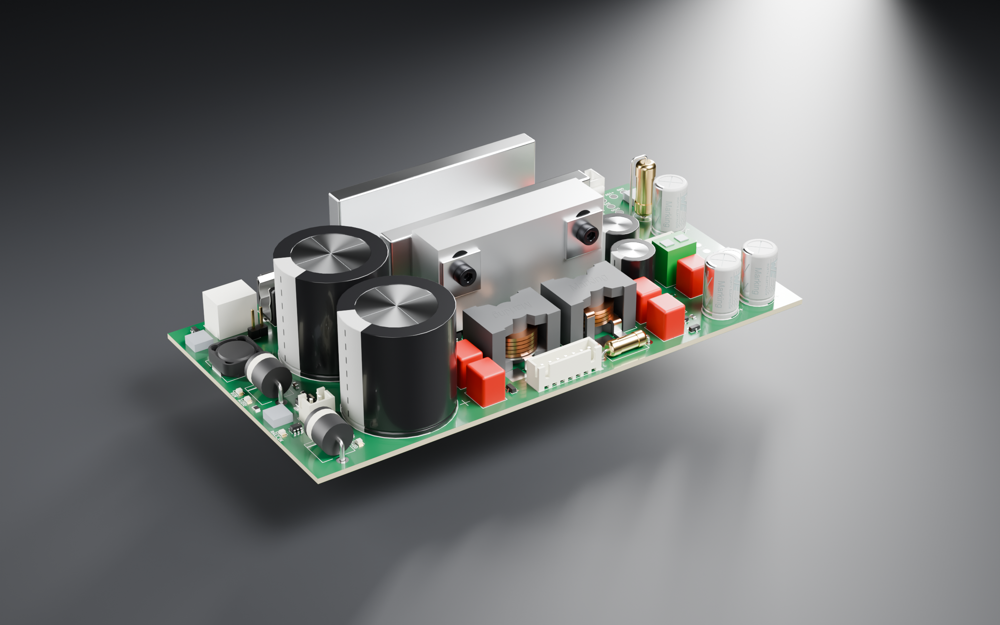
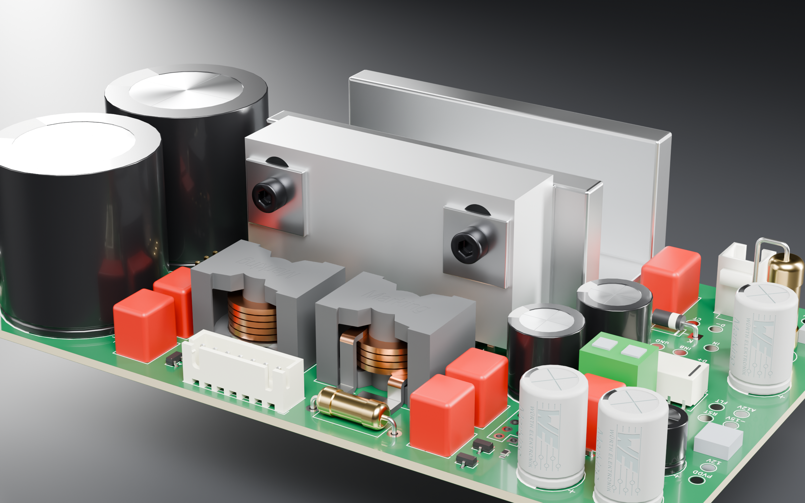
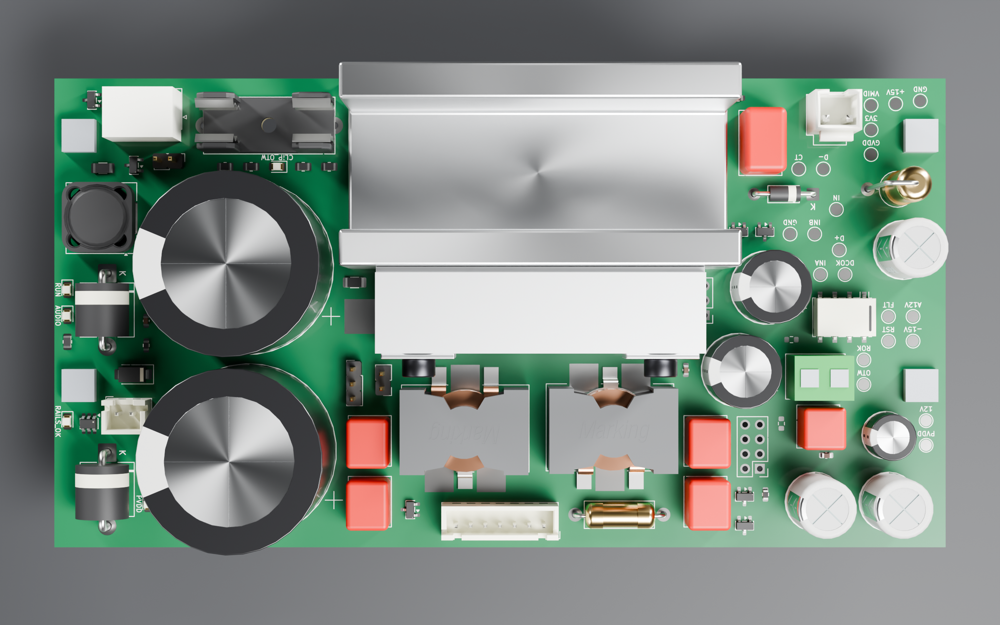

# PS28 Modern Amp

**Placa amplificadora nova para o subwoofer Infinity Primus PS28.**
TPA3255 em PBTL mono, alimentado pelo transformador original, no mesmo gabinete,
dissipador, furação e chicotes. O preamp/crossover original continua em uso.



## Estado — 2026-10-17

**Roteada e verificada em CAD. Ainda não liberada para fabricação.**

| | |
|---|---|
| Placa | 154 × 81 mm, 4 camadas, 269 footprints |
| Verificação | ERC 0 · DRC 0 · conexões abertas 0 · paridade esquema/PCB 0 |
| BOM | 235 posições com fabricante e MPN |
| Falta | revisão de layout (G2), auditoria elétrica (G1), gabarito 1:1, pedido (G3) |

Detalhes em **[estado do projeto](docs/status.md)** e **[backlog](.tasks/project-backlog.md)**.

## Como funciona

```
T1 original ─► 2 diodos + 2×4700 µF ─► PVDD 42–50 V ─► TPA3255 PBTL ─► LC ─► woofer 4 Ω
     └────► auxiliar 12 V ─► ±15 V, 3,3 V, sequenciador, supervisão
Preamp/crossover OEM (50–150 Hz) ─► relé de isolamento ─► entrada do TPA3255
```

- Sem MCU e sem rede AC na placa nova; sequência e proteções discretas.
- O TPA3255 tem o pad térmico em cima: um bloco de alumínio leva o calor ao perfil U original.
- 120–150 W é alvo em burst; 100 W contínuos é o requisito.

## Imagens

| | |
|---|---|
|  |  |

[Galeria Blender](docs/images/pcb-studio/README.md) ·
[Renders KiCad](docs/images/kicad-3d/README.md) ·
[Esquema (SVG)](docs/images/system-candidate/system-candidate.svg)

## Navegar

| Quero… | Ir para |
|---|---|
| Entender o projeto | [Arquitetura](docs/architecture.md) · [requisitos](docs/requirements.md) · [decisões](docs/decisions.md) |
| Abrir a placa | [`kicad/system-candidate/system-candidate.kicad_pro`](kicad/system-candidate/system-candidate.kicad_pro) |
| Ver toda a documentação | [Índice](docs/README.md) |
| Montar e ligar | [Montagem e primeira energização](docs/bringup.md) |
| Contribuir | [AGENTS.md](AGENTS.md) · [skills](skills/README.md) · [CHANGELOG](CHANGELOG.md) |

## Comandos

```sh
make check          # docs, tasks e testes automatizados
make erc && make drc
make thermal-fit    # fit e orçamento térmico
make render-studio  # renders Blender
make render-3d      # renders KiCad
make fab            # rascunho local de fabricação (não envia nada)
```

## Segurança

**SPK+ e SPK− são saídas ativas: nunca ligar ao GND nem à garra terra do osciloscópio.**
Nunca ligar vermelho–vermelho do T1 em ponte. Primeira energização só com
lâmpada-série no primário e sem woofer. Nenhuma compra, fabricação ou energização
sem o "ok" do proprietário. [Regras completas](docs/safety.md).

Sem licença de redistribuição definida; referências de terceiros mantêm seus direitos.
