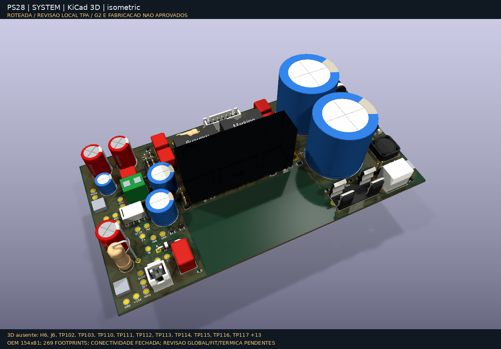
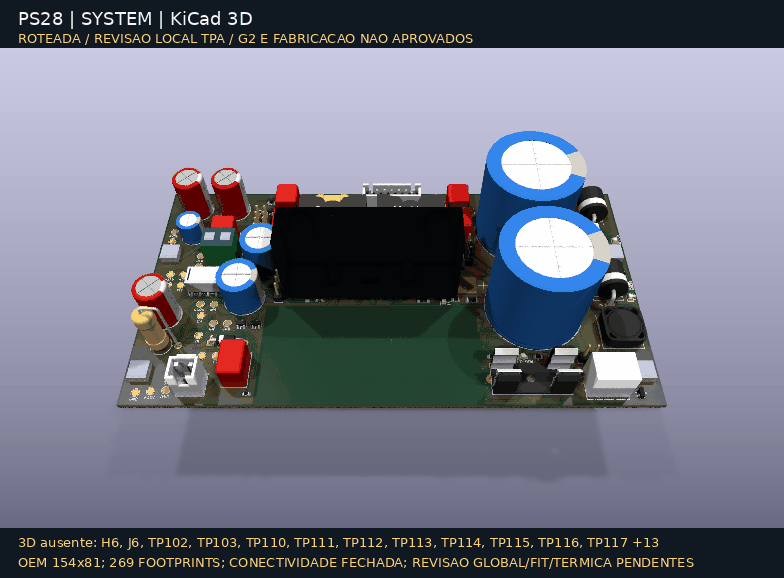

# PS28 Modern Amp

**Uma placa nova para devolver o Infinity Primus PS28 ao funcionamento.**
TPA3255 PBTL mono, preservando gabinete, T1, dissipadores, furação e chicotes OEM.
O preamp/limiter original é reaproveitado (D-032); a PCB nova substitui a principal.



## Estado atual — 2026-10-16

**Roteamento conectado; revisão de engenharia ainda não liberada para fabricação.**

- Placa única: [`kicad/system-candidate/`](kicad/system-candidate/), contorno OEM
  **154 × 81 mm**, **269 footprints**, 3.531 segmentos e 499 vias.
- **ERC 0 · DRC 0 · conexões abertas 0 · divergências esquema/PCB 0.**
- Placement local do TPA e retornos revistos; **138 testes automatizados aprovados**.
- Bloco térmico corrigido e fit nominal em CAD verificado. **Não é fit físico
  nem ensaio térmico:** o caminho dissipador→ambiente continua sem medida.
- Pendentes: revisão global e gates humanos G1/G2, qualificação BOM/CPL/JLCPCB,
  fit físico, bancada e autorização G3 antes de qualquer pedido.

Os núcleos `core-selected` e `core-oem-refined` são **estudos históricos**,
não placas alternativas do produto. Os renders atuais não mostram bancos de
componentes fora do contorno; modelos ausentes/genéricos constam no manifesto.

[Estado detalhado](docs/development-status.md) ·
[Próximos passos até produção](docs/production-roadmap.md) ·
[Revisão local TPA](docs/tpa-local-layout-review.md) ·
[Fit térmico](mechanical/thermal-block.md)

## Abrir e verificar

Abra **[`system-candidate.kicad_pro`](kicad/system-candidate/system-candidate.kicad_pro)**
no KiCad. Preserve o roteamento: os geradores históricos não devem sobrescrever
esta candidata sem snapshot e revisão de diff.

```sh
make check         # documentação, tasks, skills e testes automatizados
make erc           # ERC da candidata de sistema
make drc           # DRC, conexões abertas e paridade da candidata
make thermal-fit   # envelopes, tolerâncias, malha e orçamento calculado
make doctor        # diagnóstico local, sem instalar ferramentas
```

Regeneração das mídias (exige ferramentas/modelos locais):

```sh
make thermal-model # Blender local, STL/WRL e vistas térmicas
make render-3d     # vistas KiCad + GIFs + manifesto SHA256
```

`make fab` gera **somente um rascunho local** em `build/fab/drafts/`, com hashes
e indicação de árvore suja. Não qualifica BOM/CPL, não faz upload e não autoriza
produção. Consulte [fabricação](docs/manufacturing.md).

## Renders e esquema



[Topo](docs/images/kicad-3d/system-top.png) ·
[Base](docs/images/kicad-3d/system-bottom.png) ·
[Galeria e limitações dos modelos](docs/images/kicad-3d/README.md) ·
[Manifesto/proveniência](docs/images/kicad-3d/manifest.json)

[](docs/images/system-candidate/system-candidate.svg)

[Esquema SVG em tamanho completo](docs/images/system-candidate/system-candidate.svg) ·
[Contexto da captura](docs/images/system-candidate/README.md)

### Interface térmica OEM


Rasgos em Z = **23,65 mm**, pedestal **6 × 3 mm** sobre o PowerPAD superior,
batentes positivos independentes do CI. Resistência calculada junção→perfil:
**2,25–3,97 °C/W**, conforme hipóteses de interface; não inclui dissipação ao ambiente.

[Corte](docs/images/thermal-fit-section.png) ·
[Contato](docs/images/thermal-fit-contact.png) ·
[Orçamento térmico](docs/images/thermal-budget.png) ·
[Dimensões, tolerâncias e pendências físicas](mechanical/thermal-block.md)

## Arquitetura

- **T1 original → retificação CT com dois diodos → PVDD não regulado ≈42–50 V.**
  Auxiliar 12 V; sem primário AC na PCB nova e sem MCU.
- **Preamp/limiter OEM:** RCA L/R e LFE, crossover 50–150 Hz, volume/fase;
  interface de áudio, alimentação e proteção na placa nova conforme D-032.
- **TPA3255 PBTL → dois ramos LC → SPK±**, conforme TI SLASEA8A Fig. 31.
- Sequenciamento discreto, isolamento/mute e supervisão de rails/falhas.

120–150 W é **alvo**, não potência contínua garantida. Depende de T1, ripple,
clipping, perdas, dissipação e validação com carga e woofer reais.

[Arquitetura](docs/architecture.md) · [Decisões](docs/decisions.md) ·
[Requisitos](docs/requirements.md) · [T1](docs/transformer-reuse.md)

## Documentação e planejamento

- **Começar:** [índice técnico](docs/README.md), [estado](docs/development-status.md),
  [roadmap de produção](docs/production-roadmap.md), [CHANGELOG](CHANGELOG.md).
- **Elétrica/PCB:** [esquema](docs/schematic.md), [layout](docs/pcb-layout.md),
  [operacionalidade](docs/functional-readiness.md), [simulação](docs/simulation.md).
- **Mecânica:** [índice](mechanical/README.md), [referência OEM](mechanical/original-board-reference.md),
  [bloco térmico](mechanical/thermal-block.md).
- **Produção/bancada:** [BOM/compras](docs/procurement.md),
  [fabricação](docs/manufacturing.md), [bring-up](docs/bringup.md).
- **Trabalho:** [backlog canônico](.tasks/project-backlog.md),
  [roadmap](.tasks/ROADMAP.md), [S04](.tasks/sprints/S04.md),
  [issues GitHub](https://github.com/bernardopg/ps28-modern-amp/issues),
  [AGENTS.md](AGENTS.md), [skills](skills/README.md), [toolchain](docs/toolchain.md).

Documentos de estudos anteriores são históricos; sua situação não substitui o
[estado consolidado atual](docs/development-status.md). Referências e atribuições:
[fontes](docs/references.md), [assets](docs/assets.md), [modelos Würth](kicad/models/vendor-wurth/README.md).

## Segurança

**SPK+ e SPK− são ativos: nunca ligar ao GND nem à garra terra do osciloscópio.**
Nunca ligar vermelho–vermelho de T1 em ponte. Primeira energização somente com
limitação no primário e sem woofer, após limites numéricos aprovados pelo proprietário.

**Este push não autoriza compra, fabricação ou energização.** ERC/DRC zerados,
render ou simulação não são sign-off de hardware. [Regras e gates](docs/safety.md).

Sem licença geral de redistribuição definida; referências de terceiros mantêm seus direitos.
