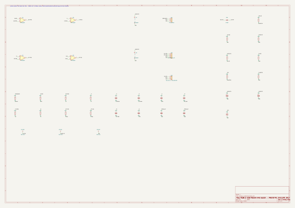

<div align="center">

# 🔊 PS28 Modern Amp
### Substituição do *plate amplifier* do Infinity Primus PS28 por um amplificador Classe D

<sub>Preservando gabinete, dutos e woofer · Projeto de engenharia em fase de requisitos — <b>não é um circuito pronto para fabricar</b></sub>

</div>

---

<div align="center">

<br>
<sub><b>Candidata de sistema D-023</b> · <code>kicad/system-candidate/</code> · núcleo OEM + bancos de importação fora do contorno · snapshot <code>617bfb1</code></sub>
</div>

## 📊 Estado

| | |
|:---|:---|
| 🧩 **Fase** | Requisitos & estudo — capturas parciais, **não** hardware validado |
| 🚧 **Gates G0–G5** | Todos **pendentes** (ERC/DRC/simulação/IA **não** são sign-off) |
| 🏭 **Fabricação / compra / energização** | **Não aprovadas** — exigem autorização humana específica |
| 🔌 **Roteamento** | Autoroteamento de estudo **463/470**, sem revisão de layout |
| 📐 **Contorno** | OEM medido **154 × 81 mm**, 204 peças · placement de estudo |

> ⚠️ **Leia antes de qualquer coisa:** ERC/DRC zerados, simulação ideal ou IA **não** aprovam hardware.
> `SPK+`/`SPK−` são ativos — **nunca** GND nem garra terra de osciloscópio.

---

## 🖼️ Renders

<div align="center">

**PCB 3D — candidata de sistema (mais recente, D-023)**


<sub>[Isométrica](docs/images/kicad-3d/system-isometric.png) · [Topo](docs/images/kicad-3d/system-top.png) · [Base](docs/images/kicad-3d/system-bottom.png) · [Órbita GIF](docs/images/kicad-3d/system-orbit.gif) · [Revisão B](docs/images/kicad-3d/selected-isometric.png) · [OEM refinada](docs/images/kicad-3d/oem-isometric.png) · **Núcleo + bancos fora do contorno, sem placement/roteamento nesses bancos**</sub>

</div>

<details open>
<summary><b>⚡ Renders funcionais — capturas elétricas (KiCad/Eeschema)</b></summary>

<br>

**Sistema completo — 204 componentes** (`system-candidate.kicad_sch`)

<div align="center">
<a href="docs/images/system-candidate/system-candidate.svg"></a>
<sub><a href="docs/images/system-candidate/system-candidate.svg">abrir SVG em tamanho cheio →</a></sub>
</div>

<table>
<tr>
<td width="50%" align="center" valign="top">
<b>Analógico protegido D-018</b><br>
<sub>32 comp. / 80 pinos / ERC 0 · 13 footprints pendentes</sub><br>
<a href="docs/images/analog-protected/analog-protected.svg"></a><br>
<sub><a href="docs/images/analog-protected/analog-protected.svg">SVG</a> · <a href="docs/images/analog-protected/analog-protected.pdf">PDF</a></sub>
</td>
<td width="50%" align="center" valign="top">
<b>Front-end LR4 (estudo)</b><br>
<sub>valores R/C explícitos · não integrado à PCB</sub><br>
<a href="docs/images/analog-front-end/analog-front-end.svg"></a><br>
<sub><a href="docs/images/analog-front-end/analog-front-end.svg">SVG</a> · <a href="docs/images/analog-front-end/analog-front-end.pdf">PDF</a></sub>
</td>
</tr>
</table>

<sub>📎 [Galeria 3D completa + proveniência](docs/images/kicad-3d/README.md) · [manifest.json](docs/images/kicad-3d/manifest.json) · [mídia da candidata](docs/images/system-candidate/README.md) · [analógico protegido](docs/images/analog-protected/README.md)</sub>

</details>

---

## 📚 Índice / Wiki

<details open>
<summary><b>🧭 Estado, roadmap e arquitetura</b></summary>

| Documento | Conteúdo |
|---|---|
| [Estado consolidado](docs/development-status.md) | Situação D-018…D-024, mapa de capturas/PCBs, bloqueios |
| [Caminho até produção](docs/production-roadmap.md) | Passos ordenados até um pedido JLCPCB |
| [Arquitetura proposta](docs/architecture.md) | Cadeia funcional planejada × capturas reais |
| [Requisitos](docs/requirements.md) | Sistema, woofer e critérios de aceitação |
| [Decisões (D-001…)](docs/decisions.md) | Baseline, topologia PBTL, crossover D-022 |
| [Índice técnico](docs/README.md) | Ordem canônica de leitura da documentação |

</details>

<details open>
<summary><b>🔬 Blocos de decisão & estudos</b></summary>

| Decisão | Bloco | Documento | Evidência |
|:---:|---|---|---|
| **D-021** | Retificador CT de T1, bulk 2×4700 µF, LM5164 12 V, janela PVDD TPS3700 | [power-d021.md](docs/power-d021.md) | 54 casos ngspice · PVDD máx. 49,84 V |
| **D-023** | Sequenciador discreto (hold ≥ 360 ms, latch FAULT) | [seq-d020.md](docs/seq-d020.md) | modelo lógico + mutações |
| **D-024** | Relé G6K-2F, mute TMUX6219, janelas DC/AUX | [iso-d019.md](docs/iso-d019.md) | 1350 casos · pino −0,158…6,47 V |
| **D-024a** | Série 3,3 kΩ + BAT54 (falha simples) | [iso-d019.md](docs/iso-d019.md) | 216 casos · ≤ −0,351 V |
| **D-022** | Crossover ajustável 50–150 Hz | [decisions.md](docs/decisions.md) | **não capturado** (ELEC-004) |

| Estudo | Documento |
|---|---|
| Interface TPA: desligamento/pré-carga (contrato D-019) | [input-power-order-study.md](docs/input-power-order-study.md) |
| VMID ativo — bloqueado por power-down | [vmid-buffer-study.md](docs/vmid-buffer-study.md) |
| Correção D-018 — VMID passivo + rail protegido | [vmid-protection.md](docs/vmid-protection.md) |
| Front-end LR4 e headroom | [analog-lr4-study.md](docs/analog-lr4-study.md) |
| Captura analógica + OPA1656 candidato | [analog-capture.md](docs/analog-capture.md) |
| Integração candidata D-020 / CAD | [integration-protection-review.md](docs/integration-protection-review.md) |
| Contrato RESET/supervisor | [reset-supervisor-contract.md](docs/reset-supervisor-contract.md) |

</details>

<details>
<summary><b>🧲 PCB, fonte e mecânica</b></summary>

| Documento | Conteúdo |
|---|---|
| [Captura elétrica](docs/schematic.md) | Estado do schematic |
| [Layout PCB](docs/pcb-layout.md) | Stackup, roteamento, planos |
| [Núcleo selecionado B](docs/selected-core.md) | 47 footprints/142 pads, ERC/DRC |
| [Primeiro núcleo (draft)](docs/core-draft.md) | Rascunho preservado |
| [Reaproveitamento de T1](docs/transformer-reuse.md) | Fonte secundária nova (D-010/D-021) |
| [Operacionalidade](docs/functional-readiness.md) | Bloqueios do produto |

</details>

<details>
<summary><b>🏭 Fabricação, bancada e governança</b></summary>

| Documento | Conteúdo |
|---|---|
| [Simulação](docs/simulation.md) | LR4/LC, R/C/headroom, contraprovas |
| [Fabricação](docs/manufacturing.md) | Gerbers/BOM/CPL em `build/` (após G3) |
| [Bring-up](docs/bringup.md) | Carga resistiva primeiro, woofer depois |
| [Segurança & gates](docs/safety.md) | Proibições, riscos R1–R7, gates G0–G5 |
| [Compras / BOM](docs/procurement.md) | Rastreabilidade de fornecedor |
| [Referências](docs/references.md) · [Auditoria de origem](docs/source-review.md) | Fontes primárias TI |
| [Toolchain](docs/toolchain.md) · [Headroom](docs/headroom.md) · [GitHub/CI](docs/github.md) | Setup, memória, CI |

</details>

<details>
<summary><b>🗂️ Planejamento, assets e mídia</b></summary>

| Documento | Conteúdo |
|---|---|
| [Roadmap](.tasks/ROADMAP.md) · [Backlog](.tasks/project-backlog.md) · [Sprint S01](.tasks/sprints/S01.md) | Planejamento canônico em `.tasks/` |
| [AGENTS.md](AGENTS.md) | Instruções únicas para todos os agentes |
| [skills/](skills/README.md) | Catálogo de skills locais |
| [CHANGELOG.md](CHANGELOG.md) | Histórico de mudanças |
| [Assets & proveniência](docs/assets.md) | Regras de mídia e licenças |
| [Galeria 3D](docs/images/kicad-3d/README.md) · [manifest](docs/images/kicad-3d/manifest.json) | Renders nativos + hashes |

</details>

---

## ▶️ Começar

```bash
make check       # documentação, tasks, skills e testes de infraestrutura
make doctor      # auditoria local, sem instalar ou alterar o sistema
make simulate    # LR4/LC, R/C/headroom e contraprovas power-order; não valida hardware
make render-3d   # galeria nativa atual; exige KiCad/Pillow/modelos locais
make eda-smoke   # parsing de containers; registra warnings conhecidos do KiCad
make erc         # apenas quando houver schematic não vazio
make drc         # apenas quando houver PCB não vazia
```

Abrir **`kicad/core-selected/ps28-modern.kicad_pro`** (revisão B) ou
**`kicad/system-candidate/system-candidate.kicad_pro`** (candidata de sistema) no KiCad.

---

<details>
<summary><b>🧾 Baseline proposta — não congelada</b></summary>

<br>

TPA3255 **PBTL** mono · transformador original **T1** reaproveitado com fonte secundária nova:
**PVDD** não regulado ≈42–50 V por retificação CT de dois diodos (D-021); auxiliar **12 V**;
fonte externa apenas bancada/fallback · RCA L/R somadas resistivamente e LFE selecionável ·
LINE com **LR4** ajustável 50–150 Hz (D-022) · volume e fase 0°/180°.
Woofer 4 Ω e alvo 120–150 W dependem de identificação, medições, excursão, clipping e térmica.
**Sem** fonte de rede na PCB e **sem** MCU na Rev. A. Detalhes: [transformador](docs/transformer-reuse.md) · [arquitetura](docs/architecture.md).

</details>

---

## 🔒 Segurança

Nunca aterrar `SPK+` ou `SPK−`; usar medição diferencial apropriada. Não conectar o woofer antes
do gate de bancada. ERC/DRC, simulação ideal ou IA **não** são sign-off. Compras, fabricação e
energização exigem autorização humana específica. Proibições, riscos e gates: [docs/safety.md](docs/safety.md).

<sub>Sem licença de redistribuição definida ainda; referências de terceiros mantêm seus direitos.</sub>
