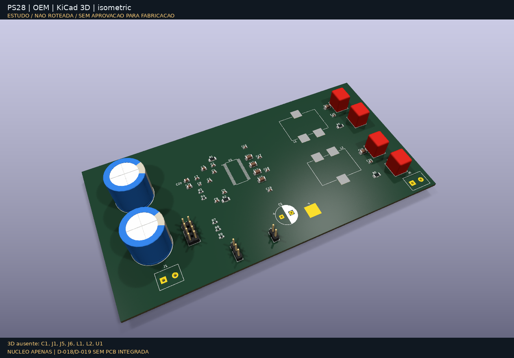
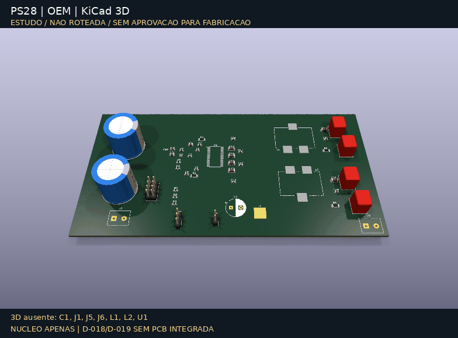

# PS28 Modern Amp

[GitHub privado](https://github.com/bernardopg/ps28-modern-amp) · [Issues e milestones](docs/github.md)

Substituição do plate amplifier do Infinity Primus PS28 por um amplificador Classe D,
preservando gabinete, dutos e woofer. Projeto de engenharia em fase de requisitos,
**não um circuito pronto para fabricar**.

## Baseline proposta — não congelada

TPA3255 PBTL mono; transformador original T1 reaproveitado com fonte secundária
nova: PVDD não regulado ≈42–50 V por retificação CT de dois diodos (D-021);
auxiliar 12 V; fonte externa apenas bancada/fallback; ver [T1](docs/transformer-reuse.md).
RCA L/R somadas resistivamente e LFE selecionável; LINE com LR4 ajustável 50–150 Hz (D-022);
volume e fase 0°/180°. Woofer 4 Ω e alvo 120–150 W dependem de identificação,
medições, excursão, clipping e térmica. Não há fonte de rede na PCB nem MCU na Rev. A.

## Começar

```bash
make check       # documentação, tasks, skills e testes de infraestrutura
make doctor      # auditoria local, sem instalar ou alterar o sistema
make simulate    # LR4/LC, R/C/headroom e contraprovas power-order; não valida hardware
make render-3d   # galeria nativa atual; exige KiCad/Pillow/modelos locais
make eda-smoke   # parsing de containers; registra warnings conhecidos do KiCad
make erc         # apenas quando houver schematic não vazio
make drc         # apenas quando houver PCB não vazia
```

[Estado consolidado e próximos bloqueios](docs/development-status.md):
D-018 é schematic analógico com alimentação/VMID, **sem PCB**; D-019 é contrato
não implementado. A galeria B/OEM foi regenerada, mas a geometria não mudou e
não representa integração do preamp/supervisor/proteção ao núcleo.

Abrir **`kicad/core-selected/ps28-modern.kicad_pro`** no KiCad (revisão atual B).
[Peças, integração ao gabinete e revisão ERC/DRC](docs/selected-core.md).
O draft anterior foi preservado em `kicad/ps28-modern.kicad_pro`.
A revisão B tem 47 componentes/footprints e 142 pads conferidos; sem footprints
críticos vazios. ERC: quatro conflitos intencionais revisados, não excluídos;
DRC: geometria/paridade sem ocorrências, 109 conexões ainda não roteadas.
Mounting points e dissipação OEM fixos; reconstrução e conferência do gabarito
original pendentes. Referência: mechanical/original-board-reference.md.
Stackup, roteamento e fabricação não aprovados.

[Incremento do front-end LR4](docs/analog-lr4-study.md): valores R/C explícitos,
151 pontos de magnitude/fase,16.384 combinações extremas e2048 amostras.
O NE5532 em12V e VMID ainda não estão qualificados; não é implementação integrada.

[Captura analógica KiCad e OPA1656 candidato](docs/analog-capture.md):21 componentes,
58 pinos/14R-C conferidos, ERC0 e modelo oficial em9 casos de rail/temperatura.
Fonte/VMID/supervisor externos e9 footprints pendentes; não é placa operacional.

[VMID físico em estudo](docs/vmid-buffer-study.md):32 casos de estabilidade no
modelo TI, carga bidirecional e LR4 acoplado; **integração bloqueada pelo power-down**
sem descarga/clamp/backfeed qualificados. RESET não protege pinos analógicos.

[Correção D-018](docs/vmid-protection.md): buffer substituído por VMID passivo e
rail analógico isolado com reserva; captura integrada32 componentes/80 pinos/ERC0.
30 quedas +3 casos partida/brownout/fonte ausente e9 casos LR4 passaram.
Causa D-017 resolvida **sob envelope declarado**, não hardware aprovado:
ESR/temperatura/pulso/sinais externos/supervisor/integração TPA continuam pendentes.

[D-019 — interface TPA e pré-carga](docs/input-power-order-study.md):
contraprovas RC de desligamento/conexão com áudio e requisitos de isolamento
pós-capacitor; sem circuito/MPNs aprovados. J102 continua separado do núcleo.
`make simulate-input-order` reproduz quatro comparações RC e duas redes acopladas
D-018, sem macro OPA/TPA; não qualifica comportamento desligado dos componentes.

## Integração candidata D-020 — trabalho em andamento
[Core+analógico/CAD/controle](docs/integration-protection-review.md): abrir
`kicad/system-candidate/system-candidate.kicad_pro` para76 componentes/212 pads,
footprints candidatos atribuídos. Analógico ainda em banco fora do contorno;
ponte de sinal aberta, proteção/mute/supervisor físicos não implementados.
Sequência executável é especificação testada, não firmware/circuito qualificado.
CAD Würth disponível/licenciado; U1 e bornes mantêm pendências explícitas.
Baselines e renders históricos abaixo não foram substituídos nem aprovados.

## Renders 3D do próprio KiCad

**Núcleo apenas; D-018/D-019 sem PCB integrada. Não roteado, modelos incompletos,
sem aprovação de fabricação.**





[Galeria completa: B/OEM, imagens e dois GIFs](docs/images/kicad-3d/README.md)
· [Auditoria e proveniência](docs/images/kicad-3d/manifest.json)
· [Bloqueios de operacionalidade](docs/functional-readiness.md).
As revisões anteriores permanecem preservadas; não foram adicionadas peças fictícias
para esconder os sete footprints sem modelo disponível.

## Mapa

- [AGENTS.md](AGENTS.md): instruções únicas para todos os agentes; CLAUDE.md é um link.
- [Índice técnico](docs/README.md): requisitos, arquitetura, riscos e gates.
- [Roadmap](.tasks/ROADMAP.md), [backlog](.tasks/project-backlog.md), [sprint S01](.tasks/sprints/S01.md).
- [Setup e auditoria](docs/toolchain.md), [skills](skills/README.md), [changelog](CHANGELOG.md).
- `reference/`: fontes externas com proveniência; PDFs locais ignorados pelo Git.
- `simulation/`, `mechanical/`, `bom/`, `tests/`, `manufacturing/`: artefatos de engenharia.
- `docs/archive/chatgpt/`: originais preservados, incompletos e não normativos.

## Segurança

Nunca aterrar SPK+ ou SPK-; usar medição diferencial apropriada. Não conectar o
woofer antes do gate de bancada. ERC/DRC, simulação ideal ou IA não são sign-off.
Compras, fabricação e energização exigem autorização humana específica.

Sem licença de redistribuição definida ainda; referências de terceiros mantêm seus direitos.
