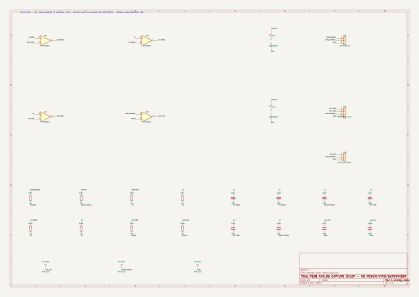

# Captura analógica isolada — OPA1656 candidato

## Incremento D-016
O NE5532 não foi declarado qualificado em12V. Selecionamos **OPA1656ID como
candidato de estudo** e capturamos a cadeia já calculada em uma folha independente:
`kicad/analog-front-end/analog-front-end.kicad_sch`. Nenhuma PCB existente foi
alterada, nem criada uma placa adicional para montagem; hierarquia/placement
OEM da integração ainda serão definidos. Fonte, VMID e supervisor permanecem externos.



[PDF nativo para zoom](images/analog-front-end/analog-front-end.pdf).

## Evidência primária e pinagem
TI **SBOS901C**, rev.set.2022:
- Figura5-3,p.3: SOIC8, OUTA1/INA−2/INA+3/V−4/INB+5/INB−6/OUTB7/V+8.
- §6.3,p.4: alimentação single4,5–36V, dual±2,25–±18V.
- §6.6,p.6: faixa de CM relativa(V−) a(V+)−2,25V. Cabeçalho de caracterização
  **VS=±18V**: não transformar simulação em garantia medida ou de extremos a12V.
- §6.6,p.7: IQ por canal máximo4,6mA a25°C no intervalo de supplies indicado,
  5,0mA na condição de temperatura especificada. Quatro canais ativos sugerem
  reservar até20mA apenas para IQ do estágio; cargas/VMID/outros blocos são adicionais.

Duas unidades físicas dual, U2 e U3; quatro instâncias de amplificador no SPICE,
conforme nota do modelo TI. KiCad usa símbolo local `PS28_ANALOG:OPA1656ID`,
flattened da representação gráfica LM2904 das bibliotecas KiCad. A equivalência
é **só gráfica/pinos**, não elétrica: conferimos cada pino acima contra TI e netlist.
Footprint candidato SOIC-8_3.9x4.9mm_P1.27mm; seleção sem stock/preço/compra ou DFM.

## Captura e comparação independente
- **21 componentes,58 pinos físicos** conferidos na netlist nativa.
-14 resistores/capacitores do caminho de sinal comparados pin-a-pin e por valor
  com `simulation/analog/lr4-rc.cir`; buffers e inversor com pinagem TI independente.
- **ERC nativo:0 violações**, sem relaxar regras ou excluir achados.
- Seis capacitores de filtro e três interfaces ainda sem footprint:9 pendências;
  MPNs de passivos/interfaces ainda TBD. Resistores/decoupling usam land patterns
  genéricos candidatos, não seleção completa. C107/C108 são bypass100nF por pacote.
- Flags de alimentação indicam **interfaces externas** AUX_12V/VMID/GND; não
  demonstram que exista fonte física ou que VMID suporte correntes/estabilidade.
- J101 recebe MONO já acoplado/biasado aVMID: **não é entrada RCA direta**.
  J102 entrega DIFF_POS/DIFF_NEG analógicos: **não são saídas de alto-falante**.

## Modelo oficial — o que passou e o que não passou
Modelo TI **SBOMAW6C / Final1.3,25AUG2022**, pin order IN+,IN−,VCC,VEE,OUT.
Referência interna do modelo é SBOS901B; datasheet consultado é C. Não presumimos
que macro/modelo reproduza todas diferenças/revisões e extremos de produção.
ZIP/modelo ficam somente em `build/`, sem republicar binários/projetos/modelo do
fabricante. Download extrai **somente OPA1656.LIB**; hash e whitelist de diretivas
`.SUBCKT/.MODEL/.ENDS` são conferidos antes de simular. Nenhum script TI executado.

Ngspice PSA em configuração **local** por SPICE_USERINIT_DIR; não modificamos
configuração global.9 casos:10,8/12/13,2V ×0/27/70°C:
-151 pontos AC10Hz–10kHz por caso, efeito contra modelo R/C ideal dentro de0,1dB;
- transiente20Hz, entrada2Vrms, divisor1/2 e janela final100ms;
- saída diferencial≈1,9924Vrms; offset diferencial modelado entre≈−0,689mV e−0,042mV;
- sinais modelados mantidos abaixo do limite CM superior usado na comparação;
- warnings de gmin/source stepping **preservados no relatório**. Alguns casos
  convergiram por transient operating-point fallback; não foram ocultados. Rejeitamos
  warnings novos ou fallback sem confirmação de convergência e conferimos RMS/DC.

São resultados **do modelo**, não medidas de bancada nem prova de THD+N, EMI,
ruído, startup, cargas reativas ou confiabilidade. VMID é ideal e não acompanha
um power-up real; não simular essa condição equivale a não validar partida.
Os16.384 corners/2048 amostras anteriores continuam sendo análise R/C, não corners
completos do modelo TI ou uma distribuição de fábrica. Nenhum gate fechado.

## Reprodução

```bash
make check
make simulate
python3 scripts/simulate_opa1656.py --fetch-model  # download explícito TI, auditado
make simulate-opa                              # requer modelo local íntegro
make analog-check                              # requer KiCad compatível com esta folha
```

CI executa modelo TI auditado e testes de regressão. O ERC/netlist nativos foram
executados localmente; fixture XML e hashes versionados evitam reutilizar evidência
após alteração de esquema. `make analog-check` gera relatórios novos em `build/analog/`.
Gerador `scripts/create_analog_capture.py` recusa sobrescrever; não regenerar sobre
captura editada. Fonte/pinout/documentos/hashes em `reference/manifest.json`.

Relatórios: [captura](../tests/reports/analog-capture-review.json) e
[modelo TI](../tests/reports/opa1656-model-study.json).

## Ainda falta
VMID físico estável (sink/source/carga capacitiva/startup), somador L/R, bypass LFE,
volume/fase, ganho/ruído/impedância completos, high-pass/limitação, proteção DC e
supervisor. Fechar MPNs/footprints passivos; integrar e revisar esquema completo;
depois placement/roteamento e validação de T1/contato térmico OEM. O núcleo de
potência segue109 conexões não roteadas e quatro ERC intencionais ainda visíveis.
