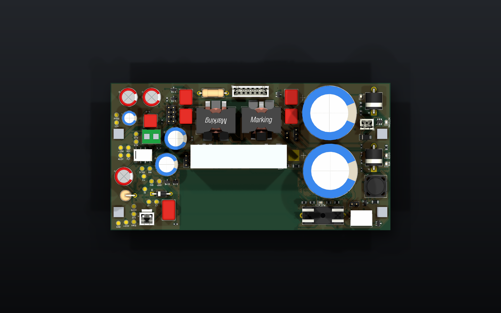
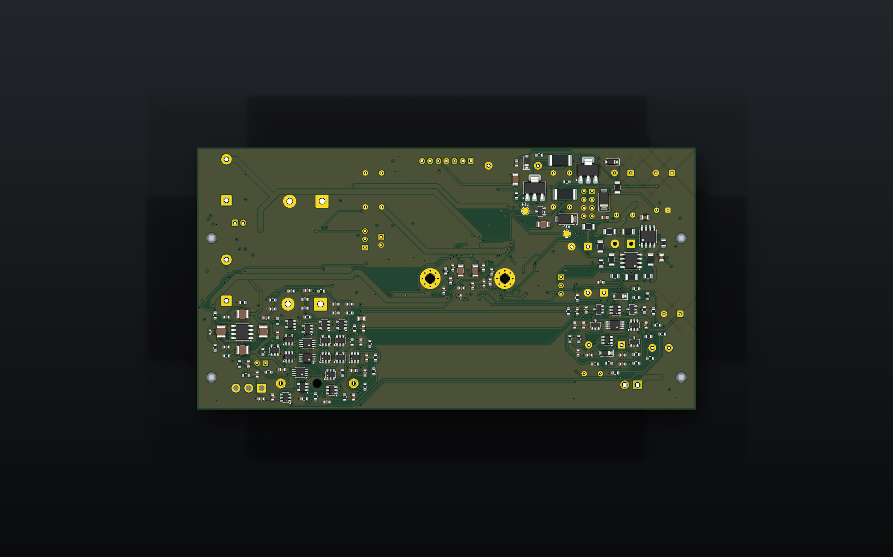

# Renders KiCad

Vistas nativas de `kicad-cli pcb render` (KiCad 10, qualidade alta) da placa
`kicad/system-candidate/`. Pillow só aplica o fundo grafite e monta o GIF.
Para a apresentação de produto, ver os [renders Blender](../pcb-studio/README.md).

| Topo | Verso |
|---|---|
|  |  |

Modelos de catálogo KiCad (cores genéricas). Sem modelo 3D: test pads, J6 e H6
(o bloco térmico usa o modelo de H5); lista no [manifesto](manifest.json).

Regenerar: `make render-3d`.
