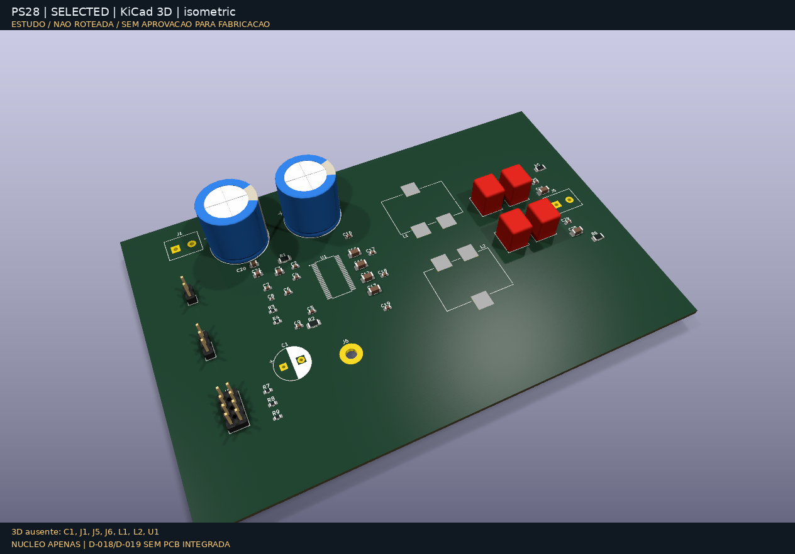
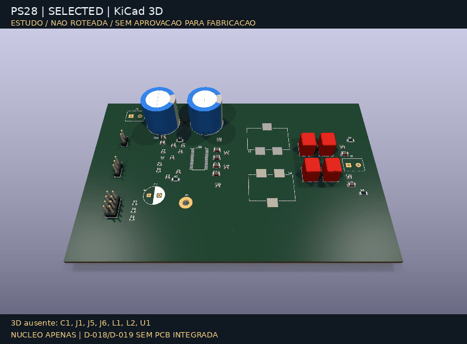

# Galeria 3D nativa — KiCad 10

Estas imagens vêm de **`kicad-cli pcb render`**, não de desenho conceitual,
renderizador CAD alternativo ou rotação artificial de uma foto. Cada GIF contém
16 renders de câmera independentes do KiCad. Pillow somente acrescenta faixas de
status e codifica os GIFs. Atualização após D-018/D-019, snapshot `e26f61f`:
**núcleo apenas, sem PCB analógica/proteção integrada**. Geometria das PCBs
preservada; faixas e manifesto agora tornam essa separação explícita.
Saída real: PNG1264×882; GIF784×578,
16frames,140ms/frame, loop. O KiCad ajustou as dimensões solicitadas ao renderizar.

## Candidata de sistema D-023 — núcleo + bancos fora do contorno


[Vista superior](system-top.png) · [Vista inferior](system-bottom.png)

`kicad/system-candidate/`: núcleo OEM no contorno e, **à direita, fora dele**, os
bancos de importação D-018 (analógico), D-021 (fonte) e D-020 (sequenciador).
Os bancos não têm placement, fit nem roteamento; só tornam visíveis os corpos e
footprints candidatos. Câmera com zoom/pan para enquadrar os bancos.

## OEM refinada — candidata de estudo


[Vista superior](oem-top.png) · [Vista inferior](oem-bottom.png)

## Revisão B — seleção de peças preservada





[Vista superior](selected-top.png) · [Vista inferior](selected-bottom.png)

## D-018/D-019 não aparecem como componentes nessas PCBs
O estudo `kicad/analog-protected/` tem schematic de 32 componentes/80 pinos e
13 footprints pendentes, **não PCB**. D-019 ainda é contrato de isolamento/
mute/pré-carga, não circuito capturado. Nenhum preamp/supervisor/chave/roteamento
foi acrescentado para aparentar integração. [Estado completo](../../development-status.md).
A inscrição em todas as imagens/GIFs acompanha essas alterações documentais,
sem inventar geometria ou alterar mounts OEM.

## Limites — não omitir ao compartilhar

- As três placas estão **sem roteamento**. Galeria não é gerber, prova de fit,
  montagem aprovada, teste térmico, nem evidência de funcionamento.
- C1/J1/J5/L1/L2 não têm modelos associados aos footprints customizados. U1
  referencia um STEP indisponível nesta instalação; por isso seu corpo não aparece.
  J6 é feature de GND, sem modelo: hole/bond na B; pad de trança sem furo na OEM.
- Os40 footprints com modelos disponíveis usam bibliotecas visuais do KiCad.
  Não são CADs específicos dos fabricantes com tolerâncias qualificadas.
- Nenhum componente fictício foi colocado para ocultar essas ausências.
- A OEM utiliza contorno inferido153×79,1mm; furação, fit e contato térmico
  permanecem não verificados. B permanece padrão de validação; OEM é estudo.

## Reprodução e rastreabilidade

```bash
make render-3d
# equivalente: python3 scripts/render_kicad_gallery.py --frames 16
```

Dependências locais: KiCad CLI e modelos de sua biblioteca, Python/Pillow e fonte
DejaVuSans. Não são instaladas automaticamente. Logs e frames brutos ficam em
`build/renders/`, fora do Git. `manifest.json` registra versão KiCad, commit-fonte,
SHA256 das PCBs/imagens/gerador, comandos e auditoria de modelos por footprint.
O contexto elétrico também vincula hashes da captura D-018/configs D-018/D-019,
quantidade de componentes e footprints pendentes, sem afirmar integração física.
O gerador prepara/verifica todos os assets em staging antes de promover os arquivos;
manifesto por último, README/notas manuais preservados. Falha de render/hash/set
incompleto não publica um sucesso novo. Regressões offline não exigem KiCad/Pillow.
Evidência consolidada: `tests/reports/documentation-media-refresh.json` — 60 testes
locais e rechecagem nativa B/OEM (ERC4,109 não roteadas; geometria/paridade0).
Nenhuma alteração das PCBs/capturas ou aprovação de fit/roteamento.
O commit-fonte antecede o commit da mídia: é a revisão elétrica/mecânica renderizada.
Ver [operacionalidade](../../functional-readiness.md) para os bloqueios do produto.
