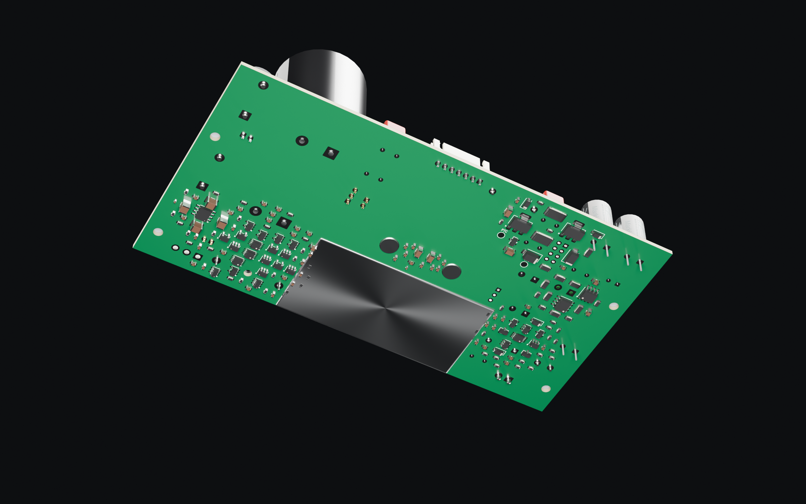

# Renders Blender

| Topo | Verso |
|---|---|
|  |  |

Cycles, 384 amostras, 2400 × 1500, AgX. Geometria da placa e dos componentes
vem do GLB exportado do KiCad. O perfil U OEM (65 × 33 × 30 mm), o shim lateral,
as plaquetas 12 × 12 mm, os parafusos M3 e os apoios H5/H6 seguem as cotas
nominais de [thermal-fit.json](../../../mechanical/thermal-fit.json).

Materiais conforme a peça real: bloco em alumínio 6061 jateado, perfil em
alumínio extrudado, capacitores com capa preta (Nichicon UHE: "white letter on
black sleeve"), terminais estanhados HASL, máscara verde padrão da fábrica.
Terminais THT cortados 2 mm abaixo da placa, como após a montagem.

Não é foto nem comprovação de fit físico; [manifesto](manifest.json).
Regenerar: `make render-studio` (prévia rápida: `PS28_STUDIO_PREVIEW=1`).
