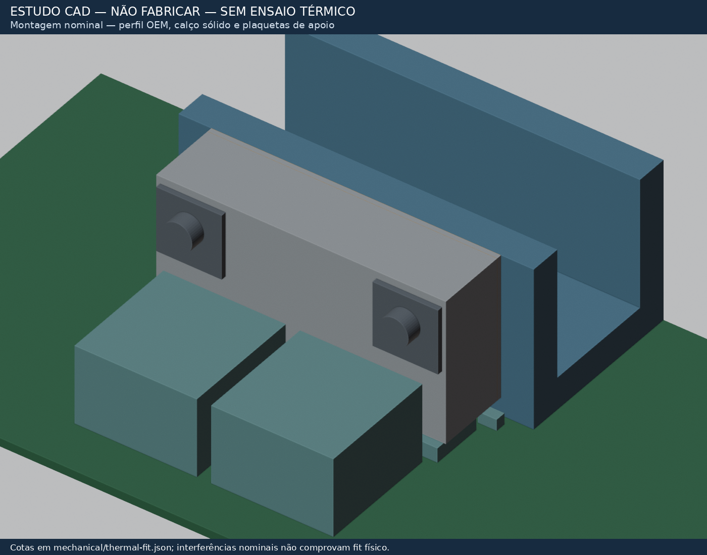
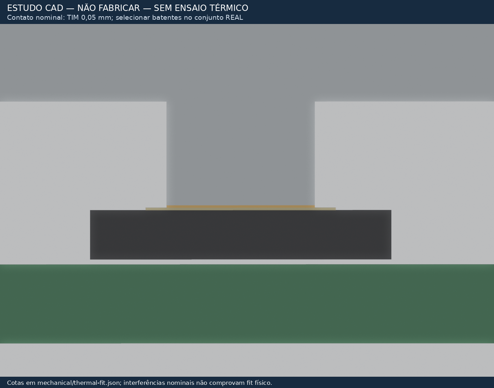
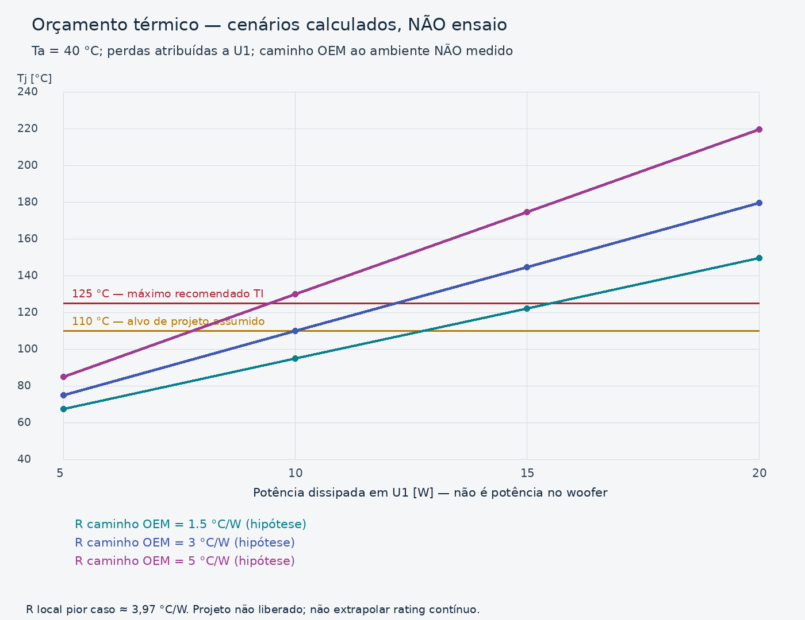

# Fit mecânico/térmico do TPA3255 — D-031, revisão 2026-10-16

**Estudo de engenharia, NÃO liberado para usinagem/montagem/fabricação.**
O fit nominal foi verificado contra a PCB atual e as medidas OEM; o desempenho
não foi medido. Fontes e hipóteses estão em `thermal-fit.json`;
evidência em `../tests/reports/thermal-fit-review.json`.



## Correções indispensáveis da revisão anterior

- Os furos OEM ficam a **23,65 mm acima da PCB**, não 6,35 mm: 6,35 mm era a
  distância à borda livre da perna de 30 mm. O bloco antigo, com topo em 13 mm,
  não alcançava esses furos. Fonte: medida do proprietário em
  `oem-heatsink-measurements.json` e `.md`, quinta rodada.
- O pedestal antigo de 8×5,2 mm excedia a área mínima garantida do pad. O novo
  pé tem **6×3 mm**, centrado na posição real U1 **(90,375; 60,375)**.
- O CI **não é batente de aperto**. Dois apoios metálicos calibrados em H5/H6
  limitam a descida. Não se aperta até o encapsulamento “assentar”.
- O exportador WRL anterior usava vértices locais sem a transformação do objeto.
  A posição em KiCad foi corrigida; teste de malha verifica limites e rasgos.
- Não se presume perfil a 50 °C porque ele servia ao classe AB. A resistência
  térmica OEM precisa ser medida/confirmada no conjunto.

## Geometria e montagem proposta

Referencial: mm, KiCad +Y para o backplate, Z=0 na face de componentes da PCB.
Fonte única de dimensões: `thermal-fit.json`. STL: `thermal-block.stl`;
WRL associado a H5 em `../kicad/models/ps28-bodies/thermal_block.wrl`.
Roscas são notas de processo, não hélices desenhadas na malha.

- Corpo Al 6061/6063 ou equivalente: **53×13×26,7 mm**, X=64…117,
  Y=54…67, Z nominal=3,3…30. Condutividade usada no cálculo: **167 W/(m·K), hipótese**.
- Pé 6×3 mm, Z inferior nominal **1,20 mm**; degrau de **2,10 mm** abaixo do corpo.
  Pad exposto mínimo DDV, rotacionado como U1: **6,72×3,85 mm**. Após orçamento
  relativo XY de ±0,25 mm, restam margens **0,11/0,175 mm**. Confirmar tolerância
  de usinagem/posicionamento antes de encomendar; não apoiar em terminais/epóxi.
- H5/H6 preservados em (79;60,5)/(102;60,5). Furação de referência Ø2,5 para
  rosca M3, profundidade nominal 8 mm no bloco. Aprovar detalhe de rosca com usinador.
- Apoios condutores: Ø externo **6 mm máximo**, altura selecionada **3,1…3,5 mm**
  (nominal 3,3). Usar espaçador nominal 3 mm e calços de precisão selecionados;
  não compensar altura apertando/deformando a PCB. As duas pilhas devem ser iguais.
- Cabeça/apoio inferior **Ø5,5 mm máximo**. Sem arruela comum Ø7 mm ou arruela de
  pressão larga: a área do verso agora tem desacoplamentos. Candidato M3×10 Allen,
  sem arruela larga; verificar rosca útil e carga na PCB, sem definir torque arbitrário.
- Furos laterais: X=70,7/110,3; **Z=23,65 mm**, rasgos verticais **6×8,4 mm**.
  O orçamento combinado de ±1 mm X e ±1,8 mm Z cabe na geometria com parafuso Ø3 mm.
  A margem residual calculada é ≈0,33 mm; o check exige pelo menos 0,20 mm para
  não aceitar rasgo nominalmente justo sem reserva de execução.
  Em Z entram medida OEM (~1 mm), ajuste (~0,2 mm) e a diferença **0,6 mm entre
  PCB OEM 1,0 mm e nova 1,6 mm**; não se presume o mesmo datum de face montada. Não há rebaixo de cabeça.
- Duas plaquetas externas **12×12×1 mm**, furo Ø3,4 a **7 mm da borda inferior/5 mm da superior**, distribuem a carga sobre
  os rasgos. O furo excêntrico reduz a projeção acima do bloco durante o ajuste. Candidato M3×20 lateral: na geometria nominal, 1 mm de plaqueta + 13 mm
  de corpo + 1 mm de interface deixam cerca de 5 mm de engate. **Conferir profundidade
  útil da rosca OEM e eventual protrusão antes de escolher o comprimento final.**

### Contato superior: ajuste, não altura presumida

O DDV especifica 1,0…1,2 mm; a soldagem acrescenta variação. O modelo visual usa
pad em Z=1,15 mm, **não uma medição**. Selecionar os apoios/calços para obter
**folga real de 0,05…0,10 mm**, preenchida por TIM fino qualificado de
condutividade **≥3 W/(m·K)**. Esse requisito ainda precisa de MPN/datasheet na BOM.

Altura dos apoios = altura real do pad + folga TIM + degrau de 2,10 mm.
O orçamento inclui até 0,10 mm de montagem: apoios necessários 3,15…3,50 mm.
Superfícies devem ser planas, limpas e sem rebarbas; comprovar contato/molhamento
na montagem. Não escolher a pilha a partir do valor máximo do encapsulamento.
Os parafusos fecham sobre os apoios, **não sobre o chip**.



### Contato lateral e vínculo elétrico

Gap nominal bloco/perfil = 1 mm. Usar **calço metálico sólido selecionado**, não
1 mm de pasta: nominal 0,90 mm de alumínio e duas películas TIM de 0,05 mm.
Espessura real do calço = vão medido menos as duas películas. Se não houver folga
positiva ou as superfícies não assentarem, corrigir a peça, não forçar a PCB.

O PowerPAD deve estar ligado a dissipador aterrado (TI, tabela de pinos).
**J6→perfil é obrigatório**, não opcional. A continuidade por parafusos/pasta ou
por pintura/anodização não é presumida. O perfil OEM foi medido como flutuante;
verificar bloco/perfil e consequências para backplate/chicotes antes de energizar.
Este vínculo é GND eletrônico, **não terra de proteção**. Nunca usar SPK± como GND.
Não reutilizar o filme isolante TO-3P sem nova análise da interface completa.

## Fit e tolerâncias: o que foi efetivamente verificado

- Mesmos contorno, U1 e furos da PCB; **nenhum cobre ou footprint foi movido**.
- Apoios no topo e cabeças inferiores não invadem courtyards próximos no orçamento
  adotado; as folgas individuais estão no JSON. O furo M3 usa os H5/H6 existentes.
- Sob o corpo, altura genérica de projeto de 2,0 mm + 0,10 mm de solda para SMDs
  baixos. Isso é envelope conservador, **não qualificação de cada MPN**.
- D303 usa máximo de catálogo Littelfuse SMCJ **2,620 mm** + 0,10 mm de solda.
  Na menor altura permitida e tolerância de plano, sobra **0,35 mm**. Nada deve
  tocar no alumínio fora do pedestal/apoios.
- Cabeças laterais/plaquetas conferidas também contra L1/L2: altura de catálogo
  WE-HCF 7443631000 de 14,5 mm + 0,10 mm de montagem, folga vertical pior caso
  **4,5 mm** até as cabeças, incluindo o orçamento Z do perfil.
- A malha tem os dois rasgos abertos em 23,65 mm, material na antiga altura errada
  de 6,35 mm e pé na cota nominal. A transformação WRL→H5 foi testada numericamente.
- O modelo do perfil U é reconstrução nominal, não digitalização do proprietário.
  As imagens de passivos são **envelopes**, não corpos exatos de fabricante.

**Conferências locais ainda necessárias, sem novo levantamento completo:**
folga útil ≥32 mm acima da PCB na posição do bloco; espaço ≥5 mm sob H5/H6;
vão lateral/rosca útil OEM; ajuste do TIM após a placa estar montada. A foto de
75 mm de folga na região dos eletrolíticos não prova folga nesta posição.
As cotas são relativas à PCB nova; um gabarito sobre a placa OEM de 1,0 mm deve
considerar o deslocamento de face decorrente da nova espessura de 1,6 mm.

## Orçamento térmico — cálculo, não ensaio nem FEM

Fonte: TI SLASEA8A §7.4. Usou-se **RθJC(top)=0,36 °C/W**. Os **2,4 °C/W** da tabela
são RθJA em um modelo particular com dissipador fixado a 85 °C e pasta 0,7 W/(m·K),
2 mil; não são uma resistência universal junção→perfil a combinar cegamente.

Modelo 1D: Rjc + TIM superior + pedestal + espalhamento assumido no corpo +
interfaces laterais/calço. Área de contato superior 18 mm²; área lateral efetiva
conservadora 600 mm²; espalhamento do corpo **0,2…1,0 °C/W, hipótese não simulada**.
Resultado: **junção→perfil ≈2,25…3,97 °C/W**. Não inclui caminho OEM→ambiente,
que reúne perfil/backplate/dissipador/convecção e permanece não medido. A área de
contato parcial e o espalhamento/voids não foram calibrados experimentalmente;
essa faixa é sensibilidade de projeto, **não limite térmico garantido**.



Para cenário ambiente 40 °C e alvo de projeto assumido Tj≤110 °C:

- **10 W perdidos em U1:** caminho OEM→ambiente precisa ser **≤3,03 °C/W**;
  perfil precisa ficar **≤70,25 °C**, no pior caso local.
- **15 W:** requer **≤0,69 °C/W** e perfil **≤50,38 °C**. Isso é exigente para
  dissipação passiva e **não foi demonstrado**.
- A tabela JSON inclui 5/10/15/20 W e ambientes 35/40/50 °C. Os cenários não são
  potência medida nem limites aprovados de ensaio. Não se assume “música = 1/8”.

Portanto, **não há suporte para prometer 150 W senoidais contínuos** por este fit.
A referência provisória de limiter/woofer de 100 W permanece; nem ela se torna
rating térmico novo sem ensaio. Confirmar perdas e temperaturas em BENCH-002,
com limites previamente aprovados pelo proprietário. Não usar OTW/OTSD como
critério de sucesso nem energizar para descobrir a tolerância do contato.

## Reprodução

```bash
python3 scripts/check_thermal_fit.py
xvfb-run -a blender --background --factory-startup --python scripts/blender_thermal_block.py
python3 scripts/render_thermal_budget.py
make render-3d
```

Ferramentas locais já instaladas; MCP Blender não disponível nesta sessão.
O `.blend` e probes intermediários ficam em `build/thermal-fit/`; STL/WRL e imagens
são artefatos versionados do **estudo**. Não enviar o STL como desenho de produção.
BOM mecânica/MPNs, acabamento, tolerâncias finais e montagem exigem revisão e OK.
